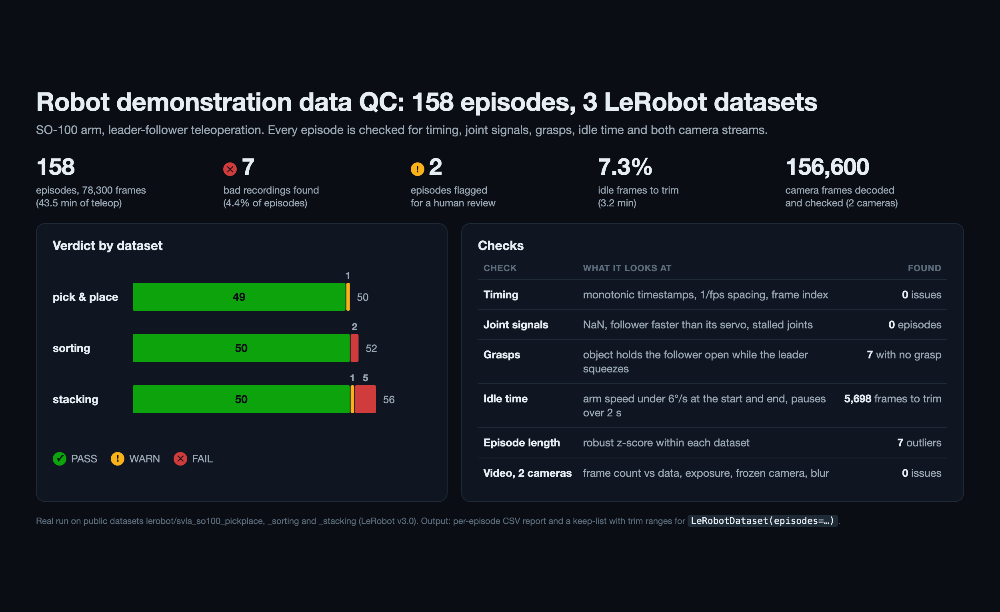
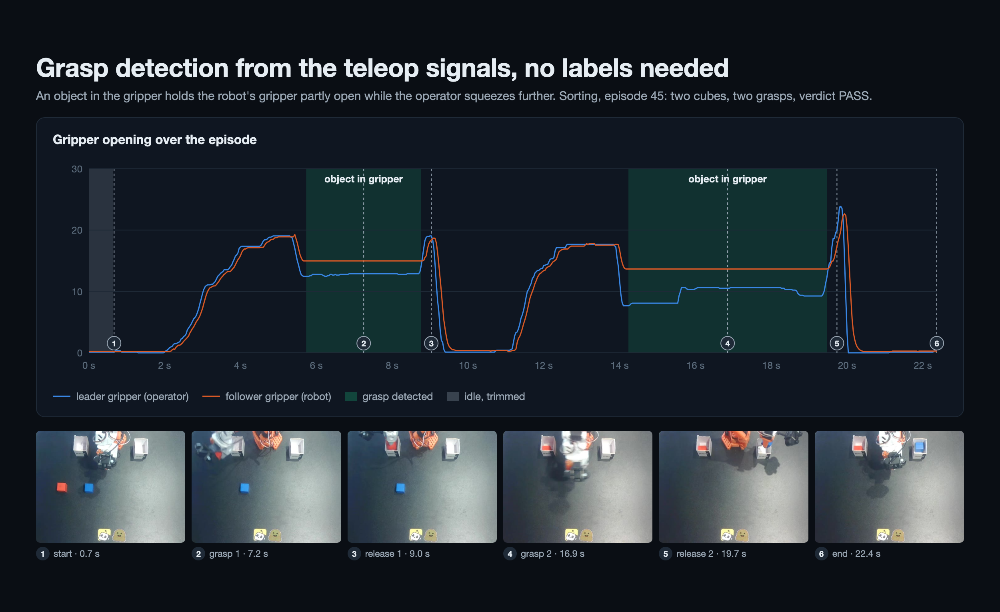

# Quality control for robot demonstration data (LeRobot, SO-100)

Imitation-learning policies learn whatever is in the demonstrations, including failed attempts, idle time and broken video. This tool checks every episode of a LeRobot v3 dataset and returns:
- a verdict for each episode;
- the reasons for that verdict;
- trim ranges for idle time.

It needs no manual labels.



## Data

Three public SO-100 datasets on Hugging Face, each with two cameras:
- `lerobot/svla_so100_pickplace`;
- `lerobot/svla_so100_sorting`;
- `lerobot/svla_so100_stacking`.

Together: 158 episodes, 78,300 frames, 43.5 minutes of teleoperation.

## Checks for every episode

- **Timing:** monotonic timestamps, dropped or duplicated frames, outliers in episode length.
- **Signals:**
  - NaN or inf values;
  - follower joints moving faster than the servo can;
  - stalled joints;
  - leader–follower tracking error.
- **Motion:** idle time at the start and end (used for the trim ranges), and long pauses.
- **Task:**
  - A grasp is detected from the gripper signals: the object holds the follower gripper partly open while the leader squeezes further.
  - No grasp means the task never happened.
  - More grasps than usual for the dataset means a re-grasp, which is worth a review.
- **Video, both cameras:**
  - frame count against data rows;
  - black or over-exposed frames;
  - a camera that freezes while the arm moves;
  - blur.



## Results

| Dataset | Episodes | PASS | WARN | FAIL | Idle frames to trim |
|---|---|---|---|---|---|
| svla_so100_pickplace | 50 | 49 | 1 (length outlier) | 0 | 13.5% |
| svla_so100_sorting | 52 | 50 | 0 | 2 (no grasp) | 4.0% |
| svla_so100_stacking | 56 | 50 | 1 (re-grasp) | 5 (no grasp) | 7.1% |
| **Total** | **158** | **149** | **2** | **7** | **7.3% (5,698 frames)** |

All 7 FAIL episodes were checked on the video: in each one the task is never performed (empty clips, a manual scene reset). Their middle frames are in `results/vis/`.

## Output

- `results/qc_episodes.csv`: every check for every episode.
- `results/qc_summary.json`: totals per dataset.
- `results/keep_episodes.json`: the episodes to keep, with trim ranges. It plugs into training as `LeRobotDataset(repo_id, episodes=[...])` plus a frame slice.

## Run

The QC runs on the CPU and needs `ffmpeg` installed for the video checks.

```bash
pip install numpy pandas pyarrow
huggingface-cli download lerobot/svla_so100_pickplace --repo-type dataset --local-dir data/svla_so100_pickplace
huggingface-cli download lerobot/svla_so100_sorting --repo-type dataset --local-dir data/svla_so100_sorting
huggingface-cli download lerobot/svla_so100_stacking --repo-type dataset --local-dir data/svla_so100_stacking
python qc.py data/svla_so100_pickplace data/svla_so100_sorting data/svla_so100_stacking
```

`export_vis.py` and `frames_at.py` export the frames and signal traces used in the figures.
