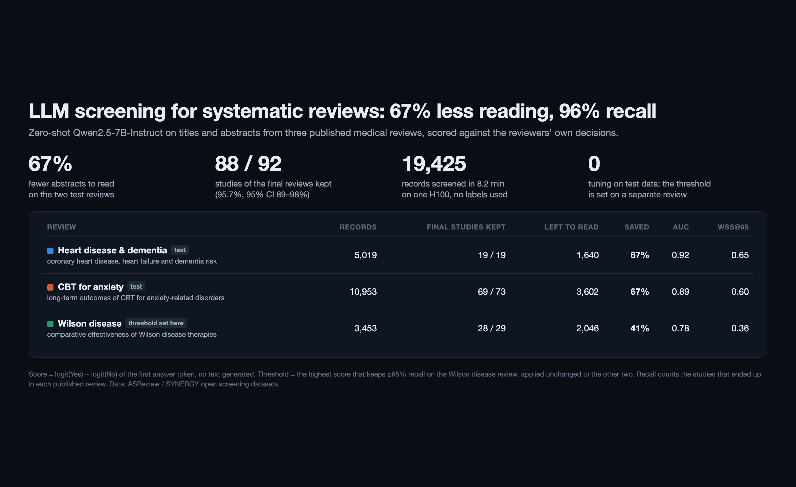
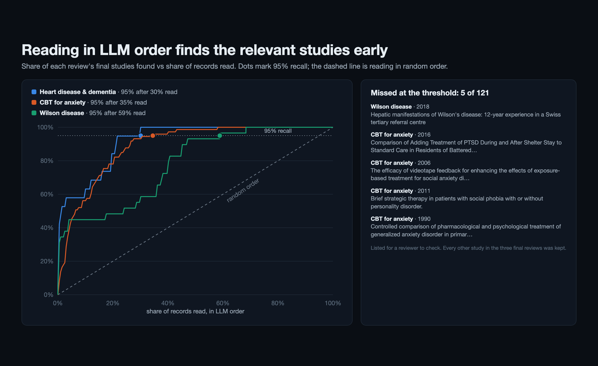

# LLM title and abstract screening for systematic reviews

Reviewers read thousands of titles and abstracts to find a few dozen relevant studies. Here an open LLM pre-screens every record against the review's inclusion criteria and is tuned for high recall, so people read only the records that can matter.



## Method

- **Model:** `Qwen/Qwen2.5-7B-Instruct`, zero-shot, with no fine-tuning.
  - For each record the model reads the review question, the inclusion and exclusion criteria, the title and the abstract.
  - P(include) is read from the logits of the first answer token (Yes vs No), so no text is generated.
- **Data:** three published medical reviews from the [SYNERGY dataset](https://github.com/asreview/synergy-dataset), with the reviewers' own decisions. 19,425 records in total.
- **No tuning on the test reviews:**
  - The decision threshold is set on one review, the development review Appenzeller-Herzog 2020. It is the highest score that still keeps at least 95% of that review's final inclusions.
  - The same threshold is then applied unchanged to the other two reviews.

## Results at the fixed threshold

| Review | Role | Records | Final inclusions kept | Recall (95% CI) | Records nobody has to read | ROC AUC |
|---|---|---|---|---|---|---|
| Appenzeller-Herzog 2020, Wilson disease treatments | development | 3,453 | 28 of 29 | 96.6% (82.8–99.4) | 40.8% | 0.781 |
| Wolters 2018, heart disease and dementia | test | 5,019 | 19 of 19 | 100% (83.2–100) | 67.3% | 0.920 |
| van Dis 2020, CBT for anxiety disorders | test | 10,953 | 69 of 73 | 94.5% (86.7–97.8) | 67.1% | 0.889 |

On the two test reviews together, it kept **88 of 92** final studies (95.7%) and saved **67%** of the reading.

All 19,425 records took 8.2 minutes on one H100 (19–22k prompt tokens per second, 17.4 GB peak memory).



## Limits

- **Low precision (1–2%).** On the test reviews the model flags about a third of the records, and people still screen those. It replaces reading the rest, not the human decision.
- **A filter, not a substitute.** Agreement with the human title and abstract decisions is low (Cohen's kappa 0.06–0.21), because the model is set for recall. Use it as a pre-screen or second screener, not as a replacement.
- **Missed studies.** The 5 final inclusions that the threshold missed are listed in `results/missed.csv`, so you can see what kind of record slips through.

## Files

- `screen.py`: scores every record and writes `preds/<review>.csv`. Each row has the record id, the score, P(include) and the human labels. The review criteria are in the script.
- `evaluate.py`:
  - computes AUC, WSS@95, recall with Wilson intervals, saved workload and kappa;
  - writes `results/metrics.json`, `results/curves.json` and `results/missed.csv`.
- `preds/run_info.json`: run time and throughput.

## Reproduce

Download the three reviews from SYNERGY and save each as `data/<review>.csv`. Each file needs the columns `record_id`, `title`, `abstract`, `label_included`, and `label_abstract_screening` where the dataset has it. Then run:

```bash
pip install torch transformers pandas numpy scikit-learn
python screen.py
python evaluate.py
```
