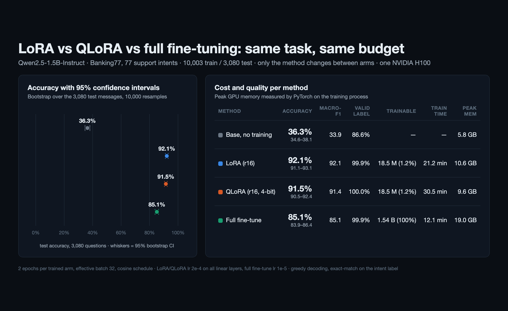

# LoRA vs QLoRA vs full fine-tuning: a controlled experiment

**Question.** For a small instruct model on a real classification task, how do LoRA, QLoRA and full fine-tuning compare on accuracy, training time and GPU memory when everything else is held fixed?



## Setup

- **Model:** `Qwen/Qwen2.5-1.5B-Instruct`.
- **Task:** Banking77, 77 customer-support intents, with 10,003 training and 3,080 test messages.
  - The model answers with the intent name.
  - An answer that is not one of the 77 labels counts as wrong.
- **Fixed for every arm:** the same prompt, data order, seed (42), 2 epochs, batch 8 × 4 accumulation steps, and evaluation. Only the fine-tuning method changes.
- **LoRA and QLoRA:**
  - rank 16, alpha 32, dropout 0.05;
  - applied to all attention and MLP projections;
  - learning rate 2e-4.
  - QLoRA loads the base model in 4-bit NF4 with double quantization.
- **Full fine-tuning:** all 1.54 B parameters, learning rate 1e-5.
- **Statistics:**
  - 95% bootstrap confidence intervals (10,000 resamples);
  - exact McNemar tests on the paired predictions for the same test messages.

## Results (NVIDIA H100 PCIe)

| Arm | Accuracy (95% CI) | Macro-F1 | Trainable parameters | Training time | Peak GPU memory |
|---|---|---|---|---|---|
| Base model, no training | 36.3% (34.6–38.1) | 0.339 | 0 | – | 5.8 GB |
| LoRA | **92.1%** (91.1–93.1) | 0.921 | 18.5 M | 21.2 min | 10.6 GB |
| QLoRA, 4-bit | 91.5% (90.5–92.4) | 0.914 | 18.5 M | 30.5 min | 9.6 GB |
| Full fine-tuning | 85.1% (83.9–86.4) | 0.851 | 1,544 M | 12.1 min | 19.0 GB |

The base model also often answers with something that is not a label: only 86.6% of its answers are valid labels, against 99.9–100% after training.

**Paired McNemar tests** on the 3,080 test messages ("A only" = messages that A gets right and B gets wrong):

| Comparison | A only | B only | p-value | Accuracy difference (95% CI) |
|---|---|---|---|---|
| LoRA vs QLoRA | 55 | 35 | 0.045 | +0.6 points (0.1 to 1.2) |
| LoRA vs full | 254 | 39 | < 1e-30 | +7.0 points (6.0 to 8.1) |
| QLoRA vs full | 247 | 52 | < 1e-30 | +6.3 points (5.3 to 7.4) |

## What this says, and what it does not

- At these settings, both adapter methods beat full fine-tuning by 6–7 points while training 1.2% of the parameters.
- QLoRA cost 0.6 points, which is small but statistically significant here. It saved 1 GB of peak memory and took 1.4× longer to train. At 1.5 B parameters the memory saving is small; it grows with model size.
- Full fine-tuning was run with one common learning rate (1e-5). A tuned schedule might close part of the gap. This experiment compares the methods at fixed, typical settings; it does not tune each one to its best.

The trained LoRA adapter is published on Hugging Face, with a model card and usage code: [Hedmm/qwen2.5-1.5b-instruct-banking77-lora](https://huggingface.co/Hedmm/qwen2.5-1.5b-instruct-banking77-lora). It was retrained with the same script and seed and reached 92.1% again.

## Files

- `run_arm.py`: trains and evaluates one arm (`--arm base|lora|qlora|full`); `--save-adapter DIR` also saves the LoRA adapter.
- `analyze.py`: computes the confidence intervals and McNemar tests, and writes `results/summary.json`.
- `results/<arm>/`:
  - `metrics.json`;
  - `preds.jsonl`, with every test prediction;
  - `train_log.jsonl`, with the loss and learning rate per step.
- `logs/`: console logs of the runs.
- `data/`: Banking77 by PolyAI, licensed CC BY 4.0.

## Reproduce

```bash
pip install torch transformers peft bitsandbytes accelerate numpy scipy scikit-learn
python run_arm.py --arm base
python run_arm.py --arm lora
python run_arm.py --arm qlora
python run_arm.py --arm full
python analyze.py
```
